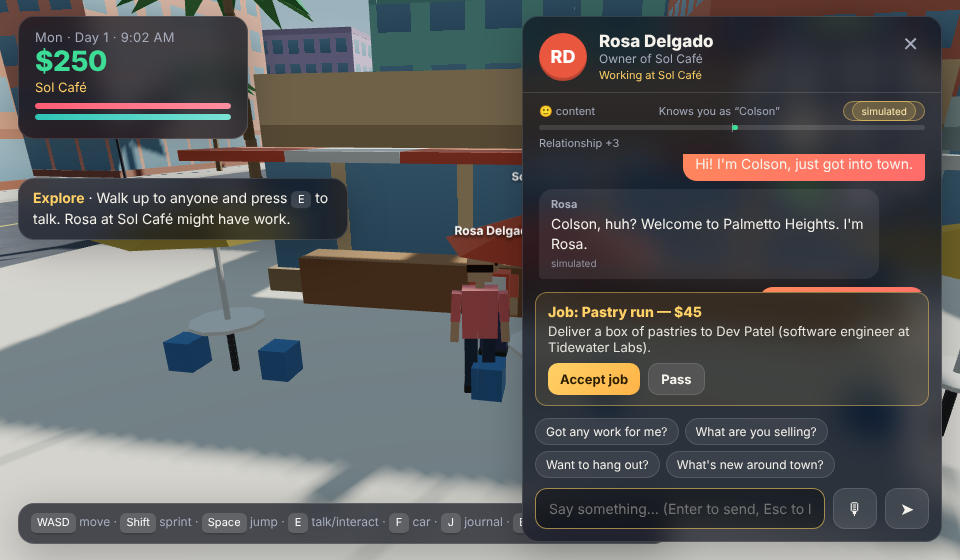
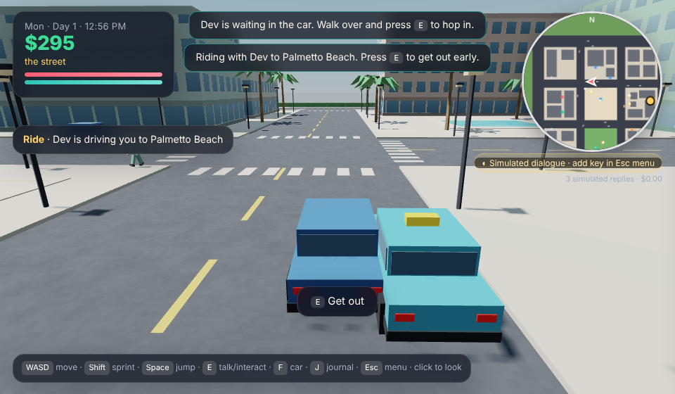
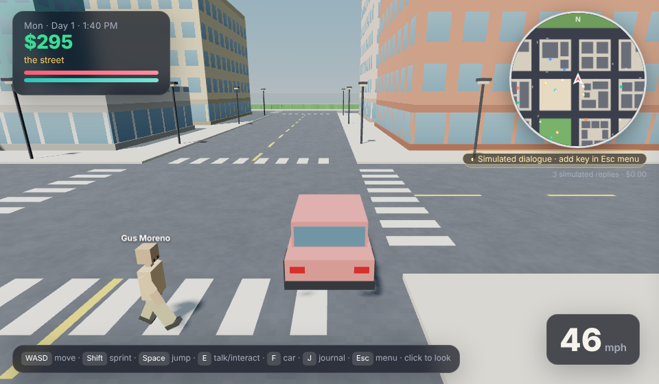
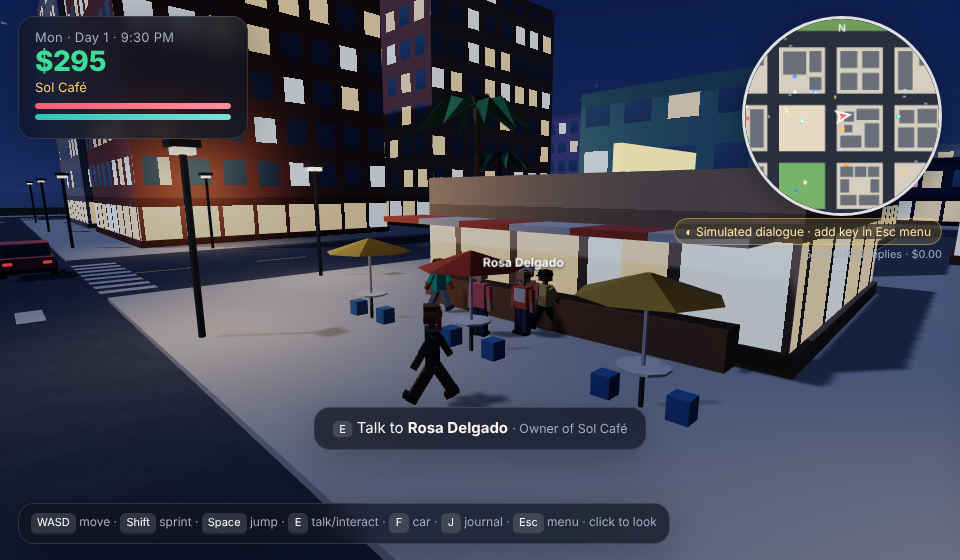

# PTO — Paid Time Off

**An open-world sandbox game where every NPC is a conversational AI agent.**

You've got paid time off. The city is yours. Palmetto Heights is a sunny coastal neighborhood with streets, traffic, a beach, a park, a plaza, a café, a used-car lot and a bar — and every person in it has a name, a job, a daily schedule, a memory, opinions about you, and things they can actually *do* in the world.

Walk up to anyone, press **E**, and type. Ask Rosa for work and she'll hand you a box of pastries to deliver. Ask Dev for a ride and he'll walk to his car, wait for you to hop in, and drive you across town. Haggle with Marco for a car. Run someone over and the witnesses will remember — and tell their friends.



| Riding with Dev | Driving | Night |
|---|---|---|
|  |  |  |

## Play

```bash
git clone https://github.com/colsonherrin/pto-game.git
cd pto-game
npm install
npm run build
npm start            # → http://localhost:5173
```

It runs out of the box **without an API key** using a clearly-labeled *simulated* dialogue brain that still drives every gameplay system (jobs, rides, trading, following, fines). For real AI conversations, either:

- **Server key (recommended):** `cp .env.example .env`, put your `OPENROUTER_API_KEY` in it, then `npm start`. The key stays on the server; the game auto-detects it.
- **Browser key:** press **Esc → AI conversations**, paste an OpenRouter key, click *Apply*. It's stored only in your browser's localStorage and sent directly to OpenRouter.

`dist/index.html` is a single self-contained file (≈190 KB, zero runtime dependencies) — you can also open it directly or host it anywhere static.

### Controls

| Key | Action |
|---|---|
| WASD / arrows | Move · drive |
| Mouse (click to capture) | Look / orbit camera · wheel to zoom |
| Shift | Sprint |
| Space | Jump · handbrake |
| E | Talk / interact / hop into a ride |
| F | Enter / exit vehicle |
| H | Horn |
| J | Journal (jobs, inventory, people, town events) |
| Esc | Pause · settings · save/load · AI cost panel |

## What's in the MVP

- **3D city:** a 4×4-block neighborhood plus beach and ocean, ~30 buildings with procedural window facades, palms, street lamps, crosswalks, a fountain plaza, a park with a pond, a taco truck, a car lot. Day/night cycle with a moving sun, real-time shadow mapping, lit windows and street lamps at night, stars and a moon.
- **Player:** third-person controller with walk/run/jump animations, collision, stamina, health, money, inventory, camera collision.
- **Vehicles:** arcade driving physics, 13 traffic cars following lanes and yielding to pedestrians, parked cars, carjacking, crashes.
- **16 named NPCs + 22 ambient residents**, each with name, age, occupation, personality, speaking style, background, goals, relationships, daily schedule, inventory, knowledge, mood and opinion of you. Ambient residents get procedurally generated identities so you really can talk to anyone.
- **Persistent memory:** NPCs remember what you told them (including your name), what you did for them and what they witnessed. Old memories are compressed into a rolling summary.
- **Non-omniscience:** an NPC only knows your name if you told them or someone gossiped it to them; they only know about events they witnessed or heard about.
- **LLM → validated world actions:** `move_to`, `follow_player`, `stop_following`, `enter_vehicle`, `drive_to`, `give_item`, `trade_item`, `offer_job`, `start_activity`, `call_contact`, `react_to_event`, `change_relationship`, `issue_fine`. The engine rejects anything invented.
- **Emergent loops:** delivery jobs, a two-step fetch quest, a vehicle delivery, persuading Theo to book Lena (which permanently changes her schedule), haggling for a car, leasing a kiosk business that pays daily, NPC rides, police heat and fines, gossip that spreads your reputation.
- **Procedural audio:** city hum, waves near the beach, birds by day, crickets at night, engine, horn, UI sounds — no sample files.
- **Save/load:** IndexedDB (localStorage fallback), autosave every 90 s and after key moments.
- **Voice:** optional Web Speech speech-to-text (🎙 in dialogue) and text-to-speech NPC replies.

## AI cost

Defaults: Tier 1 `openai/gpt-oss-20b`, Tier 2 `openai/gpt-oss-120b` via OpenRouter (both configurable). Measured by `npm run measure`, which plays a scripted 14-turn session against 6 NPCs and records the exact prompts the game builds:

| | |
|---|---|
| Avg prompt | ~962 tokens |
| Avg reply | ~59 tokens (+150 assumed hidden reasoning tokens) |
| Tier mix | 11 × Tier 1, 3 × Tier 2 |
| **Avg cost / interaction** | **≈ $0.00010** (projected) |
| Per 1,000 interactions | ≈ $0.10 |

These numbers are **projected** from measured prompt sizes × OpenRouter's Nov-2026 weighted-average prices, because the build environment had no API key. With `OPENROUTER_API_KEY` set, `npm run measure` switches to live mode and reports OpenRouter's billed `usage.cost`. In-game, **Esc** shows real-time measured cost per request. See [docs/COSTS.md](docs/COSTS.md).

## Tests

```bash
npm run typecheck   # strict TypeScript
npm test            # 22 unit tests: action validation, inference router, simulated brain, world/nav, memory
npm run test:e2e    # 22 gameplay checks in headless Chrome + screenshots
npm run measure     # AI cost measurement
```

## Docs

- [Architecture](docs/ARCHITECTURE.md)
- [Roadmap](docs/ROADMAP.md)
- [AI costs](docs/COSTS.md)

## License

MIT — see [LICENSE](LICENSE). All art, geometry and audio are generated in code; there are no third-party assets.
